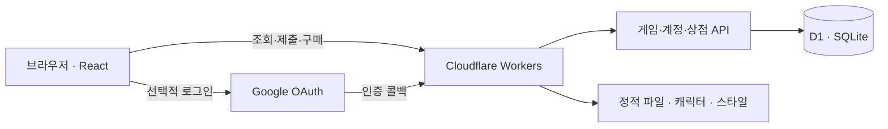

<div align="center">

# 자음모음팝 · Jamopop

**자음과 모음으로 추리하고, 콩알친구들과 함께 노는 한글 단어 게임.**

[게임 시작하기](https://play.jamopop.workers.dev/) · [기여하기](CONTRIBUTING.md) · [공개 서비스 준비](https://github.com/gaaraam/jamopop/issues/13) · [문제 제보](https://github.com/gaaraam/jamopop/issues)

**React · TypeScript · Cloudflare Workers · D1**

</div>

같은 방에서 같은 단어를 풀고, 상대의 진행판을 보며 한 판 더 이어갑니다. 혼자서는 단어가 사라진 콩알 아파트를 복구하고, 플레이로 얻은 보상으로 캐릭터와 카드를 꾸밉니다. 게임을 마치면 콩알이의 집에서 쉬거나 친구의 집에 인사를 남길 수 있습니다.

> 이 저장소는 실제 서비스의 소스입니다. 운영 사용자 데이터와 인증 비밀키는 포함하지 않습니다. 공개 출시를 위한 보강은 [상위 이슈 #13과 하위 이슈](https://github.com/gaaraam/jamopop/issues/13)에서 관리합니다.

## 먼저 한 판

**기본은 자모 5칸, 다섯 번의 시도, 방 공통 5분입니다.** ‘5칸’은 한글 다섯 글자가 아니라 풀어 쓴 자음·모음의 수입니다.

```text
바람 → ㅂ ㅏ ㄹ ㅏ ㅁ
수박 → ㅅ ㅜ ㅂ ㅏ ㄱ
```

| 색 | 알려주는 것 |
| --- | --- |
| 🟩 초록 | 자모와 위치가 모두 맞음 |
| 🟨 노랑 | 정답에 있는 자모지만 위치가 다름 |
| ⬜ 회색 | 정답에 없거나, 정답에 들어 있는 개수를 초과함 |

같은 자모를 여러 번 넣었다고 모두 노랑이 되지는 않습니다. 정답에 실제로 들어 있는 개수만큼 판정합니다. 복합모음·쌍자음·겹받침의 분해와 사전 검증은 게임 규칙에 따라 처리합니다.

1. Google 계정으로 로그인하거나 게스트로 시작합니다.
2. 대기실에서 방에 들어가거나 새 방을 만듭니다.
3. 단어를 제출하고 색상 단서를 보며 다음 단어를 추리합니다.
4. 참가자 진행판·결과를 확인하고 다음 판을 이어갑니다.

게스트 기록은 브라우저 식별에 의존합니다. 쿠키를 삭제해도 서버 기록이 삭제되는 것은 아니지만, 같은 게스트로 다시 접근하기 어려울 수 있습니다.

## 함께 풀기, 혼자 도전하기

| 모드 | 플레이 방식 |
| --- | --- |
| **일반전** | 같은 정답을 두고 경쟁. 시도 횟수와 서버 완료 기록 등을 바탕으로 순위를 계산 |
| **아이템전** | 시간 공격·방패·반사·시간 충전으로 서로의 플레이에 개입 |
| **스피드전** | 주제별 문제 묶음을 연속으로 풀이 |
| **개인 도전** | 층별 조건에 맞춰 단어를 풀고, 단어가 사라진 콩알 아파트를 복구 |
| **연습** | 다른 사람과 경쟁하기 전에 입력과 추리 방식에 익숙해지는 플레이 |

방에서는 5·6·7칸 문제, 비밀번호 설정, 초대와 방장 관리 기능을 사용합니다. 성공자는 그림 힌트를 공유할 수 있고, 관전자는 제출 완료한 단어와 판정을 볼 수 있습니다. 관전자 채팅은 참가자 채팅과 분리됩니다.

대기실·방 채팅, 캐릭터 옆 말풍선, 응원 효과, 친구 요청과 방 초대도 제공합니다. 다크 모드와 작은 창에서 사용하는 엑셀 형태의 미니 모드가 있습니다.

## 플레이가 남는 방식

| 보상·공간 | 역할 |
| --- | --- |
| **레벨·경험치** | 플레이에 따라 성장하고 캐릭터를 해금 |
| **상황별 칭호** | 특정 플레이 상황에서 얻어 닉네임 옆에 장착 |
| **골드·상점** | 캐릭터 스킨, 참가자 카드 스킨, 집 가구 구매 |
| **캐릭터 스킨** | 콩알친구들 자체의 모습 변경 |
| **카드 스킨** | 게임방 참가자 카드의 배경·테두리 효과 변경 |
| **개인 도전 보상** | 스테이지 진행으로 전용 스킨 획득 |
| **콩알이의 집** | 가구 배치, 캐릭터 돌보기, 친구의 저장된 집 방문 |

집의 콩알이는 좌우로 걷고 쉬며 쓰다듬기·간식·놀이에 반응합니다. 집은 **고정 1.6:1 좌표계**를 사용하므로 PC와 모바일에서 가구 위치는 같고 표시 배율이 달라집니다.

돌보기 세 종류와 친구 방문 보상으로 **하루 최대 4점**의 친밀도를 얻습니다. 한국 날짜 기준으로 중복 적립을 막으며, 접속하지 않았다고 친밀도가 줄지는 않습니다.

| 친밀도 | 해금되는 스킨 |
| --- | --- |
| 12 | 낮잠 친구 토콩 |
| 36 | 간식 대장 냥콩 |
| 72 | 별꿈 친구 곰콩 |

친구 방문은 **저장된 집을 보는 비동기 방문**입니다. 같은 공간에서 실시간으로 함께 움직이는 기능은 아닙니다. 캐릭터의 자율 이동도 화면에서 처리하며 이동할 때마다 서버에 요청하지 않습니다.

## 개발자 빠른 시작

필요한 도구는 **Node.js 24, npm, Git**입니다. 로컬 게스트 플레이에는 운영 Cloudflare 토큰이나 Google 로그인 비밀키가 필요하지 않습니다.

```sh
git clone https://github.com/gaaraam/jamopop.git
cd jamopop
npm ci
npm run dev
```

브라우저에서 **http://127.0.0.1:5173** 을 엽니다.

첫 실행은 앱 빌드 → 로컬 D1의 미적용 SQL 실행 → Wrangler 로컬 서버 실행 순서입니다. 처음에는 빌드가 끝날 때까지 기다려 주세요.

> **현재 개발 명령은 HMR 서버가 아닙니다.** 소스를 수정했다면 서버를 종료하고 `npm run dev`를 다시 실행합니다. 로컬 데이터는 `.wrangler/state`에 유지됩니다.

Google 로그인과 Sites 기록 연결은 운영 인증 설정에 의존합니다. 기본 로컬에서는 게스트로 확인하고, 인증·이전 로직은 테스트로 검증합니다. 편의를 위해 운영 DB를 로컬에 연결하지 마세요.

### 명령어

| 명령 | 하는 일 |
| --- | --- |
| `npm run dev` | 빌드 → 로컬 DB 준비 → 5173 포트 실행 |
| `npm run ci` | 공개 소스 검사 → 테스트 → 타입 검사 → 빌드 |
| `npm test` | 게임·계정·보상·복구·이전 등의 자동 테스트 |
| `npm run typecheck` | TypeScript 타입 검사 |
| `npm run build` | 앱과 Worker 설정 생성 |
| `npm run db:local` | 빌드된 설정으로 로컬 DB에 미적용 SQL 실행 |
| `npm run deploy` | 스키마 기준과 배포 대상을 검사한 뒤 운영 배포. 운영자 전용 |

<details>
<summary>로컬 실행이 막힐 때</summary>

- **Node 버전 오류:** `node --version`이 24.x인지 확인합니다.
- **수정이 화면에 안 보임:** 서버를 종료한 뒤 `npm run dev`로 다시 빌드합니다.
- **DB 설정/테이블 오류:** `npm run build` 후 `npm run db:local`을 실행합니다. `dist/server/wrangler.json`이 필요합니다.
- **5173 포트 사용 중:** 기존 로컬 서버를 먼저 종료합니다.
- **Google 로그인이 안 됨:** 기본 로컬 환경의 지원 범위는 게스트 플레이입니다. 운영 비밀키를 복사해 해결하지 않습니다.
- **문제 제보:** 실행 명령, Node 버전, 재현 순서, 개인정보를 제거한 오류를 첨부합니다. DB 파일이나 쿠키는 첨부하지 않습니다.

</details>

## 서비스가 돌아가는 구조



- **화면:** React와 TypeScript. 라우트와 API는 `app/`에 있습니다.
- **빌드·실행:** Vinext + Vite로 Cloudflare Worker와 정적 파일을 생성합니다. 일반적인 Next.js 호스팅 설정을 그대로 적용하는 구성은 아닙니다.
- **저장:** D1과 SQL 마이그레이션. Drizzle 스키마·연결 코드를 함께 사용합니다.
- **동기화:** 현재는 적응형 주기 조회입니다. 채팅/진행 중에는 빠르게, 완료·유휴 상태에서는 느리게 갱신합니다. WebSocket 기반이라고 가정하면 안 됩니다.
- **인증·기록 이전:** Google 로그인과 별도의 기존 Sites 계정 소유 확인 흐름을 사용합니다. 같은 이메일·닉네임이라는 이유만으로 기록을 합치지 않습니다.
- **운영:** 사용자 활동, 문의, 공지 등을 관리자 화면에서 관리합니다.

### 수정하려는 기능에서 코드 찾기

| 작업 | 출발점 |
| --- | --- |
| 자모 분해·판정 | [lib/game.ts](lib/game.ts) |
| 한글 입력·키보드 | [lib/input.ts](lib/input.ts), [components/game/word-controls.tsx](components/game/word-controls.tsx) |
| 제출·복구 | [lib/submission.mjs](lib/submission.mjs), [lib/recovery.mjs](lib/recovery.mjs) |
| 동기화·조회 빈도 | [lib/sync-policy.mjs](lib/sync-policy.mjs), [lib/sync-client.ts](lib/sync-client.ts) |
| 방 API | [app/api/game/route.ts](app/api/game/route.ts) |
| 캐릭터·스킨·상점 | [lib/companions.ts](lib/companions.ts), [lib/skins.ts](lib/skins.ts), [app/api/shop/route.ts](app/api/shop/route.ts) |
| 개인 도전·이야기 | [lib/solo.ts](lib/solo.ts), [lib/solo-story.ts](lib/solo-story.ts) |
| 집·돌보기·방문 | [app/home/page.tsx](app/home/page.tsx), [app/api/home/life/route.ts](app/api/home/life/route.ts), [lib/home-life.ts](lib/home-life.ts) |
| 공통 헤더 | [components/game/service-header.tsx](components/game/service-header.tsx) |
| 인증 | [build/google-auth.mjs](build/google-auth.mjs), [build/migration-auth.mjs](build/migration-auth.mjs) |

```text
app/          페이지 · API · 스타일
components/   게임과 공통 UI
lib/          규칙 · 입력 · 동기화 · 성장 · 꾸미기
hooks/        React 훅
db/           DB 스키마와 연결
drizzle/      순서대로 적용하는 SQL
public/       캐릭터 · 스킨 · 폰트 · 사전 등 정적 파일
tests/        동작 검증과 회귀 테스트
scripts/      로컬 실행 · 검사 · 배포
build/        Worker 진입 및 인증 코드
docs/         디자인 기준 · 배포 · 기능별 운영 문서
```

## 바꾸더라도 지켜야 하는 것

**진행 중인 판과 이미 획득한 기록을 보존합니다.** 화면이 바뀌어도 사용자의 결과·보상·소유권이 바뀌면 안 됩니다.

| 경계 | 확인할 내용 |
| --- | --- |
| 클라이언트 ↔ 서버 | 화면의 성공 표시만 믿고 보상을 지급하지 않기. 시간·결과·재화·권한은 서버 기준 |
| 제출 ↔ 재시도 | 응답이 늦거나 끊겨도 한 제출이 두 번 반영되지 않기 |
| 이전 판 ↔ 새 판 | 늦게 도착한 응답으로 새 판을 덮어쓰지 않기 |
| 게임 입력 ↔ 채팅 | 한글 조합 중 Enter, 포커스, 백틱 단축키가 서로 간섭하지 않기 |
| 게스트 ↔ 회원 | 로그인·이전 연결 과정에서 기존 프로필과 보상을 덮어쓰지 않기 |
| 공개 정보 ↔ 개인 정보 | 다른 사람에게 이메일·인증값·미제출 정답 등을 노출하지 않기 |
| DB 변경 ↔ 배포 | 기존 SQL 수정 대신 새 마이그레이션 추가, 운영 적용 확인 후 기준 갱신 |

이 표는 개발 시 검증할 기준이며, 모든 상황에 대한 무결성·보안 보증을 의미하지 않습니다.

## 검증하고 기여하기

```sh
npm run ci
```

자동 테스트는 입력·판정·순위, 제출 중복·복구, 시간 종료, 계정 이전, 상점·보상, 친구·초대, 방 비밀번호, 집 돌보기 등을 다룹니다. 테스트 개수보다 **바꾼 행동이 실제로 검증되는지**를 우선합니다.

UI 변경은 브라우저 확인이 추가로 필요합니다.

| 변경 | 직접 확인할 흐름 |
| --- | --- |
| 입력·게임판 | 한글 조합 → 지우기 → 제출 → 다음 입력, 채팅 후 게임 복귀 |
| 비동기 처리 | 제출 직후 새로고침, 일시 끊김, 응답 지연, 다음 판 전환 |
| 꾸미기·상점 | 보유/미보유 표시, 장착, 새로고침 후 유지, 다른 화면 반영 |
| 모바일 UI | 실제 휴대폰의 키보드·주소창·채팅과 화면 겹침 |
| 집 | PC/모바일 동일 배치, 저장 후 복원, 친구 방문 권한 |

기여 흐름은 **Issue → 작업 브랜치 → PR → 운영자 검토·병합**입니다. PR에는 문제, 변경 결과, 검증 방법을 쓰고 UI 변경은 전후 화면을 첨부해 주세요. 큰 변경은 먼저 이슈에서 범위를 맞춥니다.

시작할 작업은 [공개 서비스 준비 #13](https://github.com/gaaraam/jamopop/issues/13)에서 고를 수 있습니다. 첫 판 경험, 모바일 품질, 신고·차단, 개인정보 운영, 안정성, SEO, 재방문 개선을 각각 별도 이슈로 관리합니다. **계획된 항목을 이미 제공하는 기능으로 취급하지 않습니다.**

[기여 규칙](CONTRIBUTING.md) · [보안 제보](SECURITY.md)

## 배포는 어떻게 이루어지나요?

```text
작업 브랜치 → PR 검토 → 운영자가 main에 병합
                              ↓
                    Cloudflare Workers Builds
                    공개 소스 검사 · 테스트 · 타입 검사 · 빌드
                              ↓
                    스키마 기준·배포 대상 확인
                              ↓
                    Workers 운영 배포
```

자동 배포는 Cloudflare가 담당합니다. GitHub Actions는 수동 검사 용도로 남아 있습니다. 자동 검사는 현재 **main 병합 후, 배포 전**에 실행하므로 PR 단계에서 자동 검사가 보장되는 것은 아닙니다. 검사나 빌드가 실패하면 기존 배포가 계속 서비스됩니다.

**운영 DB 마이그레이션은 자동 실행하지 않습니다.** SQL을 바꾼 PR은 복구 지점 확보 → 운영 SQL 적용 → 데이터·구조 확인 → `deploy-schema.json` 해시 갱신 → 배포 순서를 따릅니다. 배포 가드를 통과시키기 위해 먼저 해시만 바꾸면 안 됩니다.

| 문서 | 내용 |
| --- | --- |
| [배포와 복구](docs/deployment.md) | 환경 변수, 인증 정보, DB 적용, 롤백 |
| [디자인 체계](docs/design-system.md) | 화면과 컴포넌트 기준 |
| [타이포그래피](docs/typography.md) | 넥슨 Lv.1 고딕·Pretendard 사용 기준 |
| [집·가구](docs/kongal-home-release.md) | 집과 가구 관련 구현·운영 사항 |
| [돌보기·방문](docs/home-life-release.md) | 친밀도, 방문 권한, 보상, 검증 |
| [카드 스킨](docs/card-skins-release.md) | 참가자 카드 꾸미기 |

## 운영 데이터와 이용 조건

운영 DB·사용자 기록·로그인 비밀키는 저장소에 없습니다. 저장소를 복제해도 실제 회원 데이터는 내려오지 않습니다. 테스트에는 별도의 로컬 데이터를 사용합니다.

버그 제보나 PR에 **실제 채팅, 이메일, 쿠키, 토큰, DB 백업**을 올리지 마세요. 보안 문제는 공개 이슈 대신 [SECURITY.md](SECURITY.md)의 절차를 따릅니다.

사전의 출처와 이용 조건은 [NOTICE.txt](public/dictionaries/NOTICE.txt), [SOURCE.txt](public/dictionaries/SOURCE.txt)를 확인해 주세요.

**프로젝트 전체에 적용할 오픈소스 라이선스는 아직 정하지 않았습니다.** 저장소 공개가 코드·캐릭터·스킨의 자유로운 재배포나 상업적 사용 허가를 뜻하지는 않습니다.

[개인정보처리방침](https://play.jamopop.workers.dev/privacy) · [이용약관](https://play.jamopop.workers.dev/terms) · [서비스 문의](https://play.jamopop.workers.dev/support)
