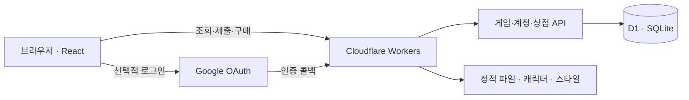

# 개발 환경과 코드 안내

[기여 지침](../CONTRIBUTING.md) · [README](../README.md)

## 개발자 빠른 시작

필요한 도구는 **Node.js 24, npm, Git**입니다. 로컬 게스트 플레이에는 운영 Cloudflare 토큰이나 Google 로그인 비밀키가 필요하지 않습니다.

```sh
git clone https://github.com/gaaraam/jamopop.git
cd jamopop
npm ci
npm run dev
```

브라우저에서 **http://127.0.0.1:5173** 을 엽니다.

첫 실행은 앱 빌드 → 로컬 D1의 미적용 SQL 실행 → Wrangler 로컬 서버 실행 순서입니다. 처음에는 빌드가 끝날 때까지 기다려 주세요.

> **현재 개발 명령은 HMR 서버가 아닙니다.** 소스를 수정했다면 서버를 종료하고 `npm run dev`를 다시 실행합니다. 로컬 데이터는 `.wrangler/state`에 유지됩니다.

Google 로그인과 Sites 기록 연결은 운영 인증 설정에 의존합니다. 기본 로컬에서는 게스트로 확인하고, 인증·이전 로직은 테스트로 검증합니다. 편의를 위해 운영 DB를 로컬에 연결하지 마세요.

### 명령어

| 명령 | 하는 일 |
| --- | --- |
| `npm run dev` | 빌드 → 로컬 DB 준비 → 5173 포트 실행 |
| `npm run ci` | 공개 소스 검사 → 테스트 → 타입 검사 → 빌드 |
| `npm test` | 게임·계정·보상·복구·이전 등의 자동 테스트 |
| `npm run typecheck` | TypeScript 타입 검사 |
| `npm run build` | 앱과 Worker 설정 생성 |
| `npm run db:local` | 빌드된 설정으로 로컬 DB에 미적용 SQL 실행 |
| `npm run deploy` | 스키마 기준과 배포 대상을 검사한 뒤 운영 배포. 운영자 전용 |

<details>
<summary>로컬 실행이 막힐 때</summary>

- **Node 버전 오류:** `node --version`이 24.x인지 확인합니다.
- **수정이 화면에 안 보임:** 서버를 종료한 뒤 `npm run dev`로 다시 빌드합니다.
- **DB 설정/테이블 오류:** `npm run build` 후 `npm run db:local`을 실행합니다. `dist/server/wrangler.json`이 필요합니다.
- **5173 포트 사용 중:** 기존 로컬 서버를 먼저 종료합니다.
- **Google 로그인이 안 됨:** 기본 로컬 환경의 지원 범위는 게스트 플레이입니다. 운영 비밀키를 복사해 해결하지 않습니다.
- **문제 제보:** 실행 명령, Node 버전, 재현 순서, 개인정보를 제거한 오류를 첨부합니다. DB 파일이나 쿠키는 첨부하지 않습니다.

</details>

## 서비스가 돌아가는 구조



- **화면:** React와 TypeScript. 라우트와 API는 `app/`에 있습니다.
- **빌드·실행:** Vinext + Vite로 Cloudflare Worker와 정적 파일을 생성합니다. 일반적인 Next.js 호스팅 설정을 그대로 적용하는 구성은 아닙니다.
- **저장:** D1과 SQL 마이그레이션. Drizzle 스키마·연결 코드를 함께 사용합니다.
- **동기화:** 현재는 적응형 주기 조회입니다. 채팅/진행 중에는 빠르게, 완료·유휴 상태에서는 느리게 갱신합니다. WebSocket 기반이라고 가정하면 안 됩니다.
- **인증·기록 이전:** Google 로그인과 별도의 기존 Sites 계정 소유 확인 흐름을 사용합니다. 같은 이메일·닉네임이라는 이유만으로 기록을 합치지 않습니다.
- **운영:** 사용자 활동, 문의, 공지 등을 관리자 화면에서 관리합니다.

### 수정하려는 기능에서 코드 찾기

| 작업 | 출발점 |
| --- | --- |
| 자모 분해·판정 | [lib/game.ts](../lib/game.ts) |
| 한글 입력·키보드 | [lib/input.ts](../lib/input.ts), [components/game/word-controls.tsx](../components/game/word-controls.tsx) |
| 제출·복구 | [lib/submission.mjs](../lib/submission.mjs), [lib/recovery.mjs](../lib/recovery.mjs) |
| 동기화·조회 빈도 | [lib/sync-policy.mjs](../lib/sync-policy.mjs), [lib/sync-client.ts](../lib/sync-client.ts) |
| 방 API | [app/api/game/route.ts](../app/api/game/route.ts) |
| 캐릭터·스킨·상점 | [lib/companions.ts](../lib/companions.ts), [lib/skins.ts](../lib/skins.ts), [app/api/shop/route.ts](../app/api/shop/route.ts) |
| 개인 도전·이야기 | [lib/solo.ts](../lib/solo.ts), [lib/solo-story.ts](../lib/solo-story.ts) |
| 집·돌보기·방문 | [app/home/page.tsx](../app/home/page.tsx), [app/api/home/life/route.ts](../app/api/home/life/route.ts), [lib/home-life.ts](../lib/home-life.ts) |
| 공통 헤더 | [components/game/service-header.tsx](../components/game/service-header.tsx) |
| 인증 | [build/google-auth.mjs](../build/google-auth.mjs), [build/migration-auth.mjs](../build/migration-auth.mjs) |

```text
app/          페이지 · API · 스타일
components/   게임과 공통 UI
lib/          규칙 · 입력 · 동기화 · 성장 · 꾸미기
hooks/        React 훅
db/           DB 스키마와 연결
drizzle/      순서대로 적용하는 SQL
public/       캐릭터 · 스킨 · 폰트 · 사전 등 정적 파일
tests/        동작 검증과 회귀 테스트
scripts/      로컬 실행 · 검사 · 배포
build/        Worker 진입 및 인증 코드
docs/         디자인 기준 · 배포 · 기능별 운영 문서
```

## 변경과 검증

제품·디자인·데이터 보존 원칙, 변경별 검증 기준과 PR 작성 방법은 [기여 지침](../CONTRIBUTING.md)에서 관리합니다.

## 배포는 어떻게 이루어지나요?

```text
작업 브랜치 → PR 검토 → 운영자가 main에 병합
                              ↓
                    Cloudflare Workers Builds
                    공개 소스 검사 · 테스트 · 타입 검사 · 빌드
                              ↓
                    스키마 기준·배포 대상 확인
                              ↓
                    Workers 운영 배포
```

자동 배포는 Cloudflare가 담당합니다. GitHub Actions는 수동 검사 용도로 남아 있습니다. 자동 검사는 현재 **main 병합 후, 배포 전**에 실행하므로 PR 단계에서 자동 검사가 보장되는 것은 아닙니다. 검사나 빌드가 실패하면 기존 배포가 계속 서비스됩니다.

**운영 DB 마이그레이션은 자동 실행하지 않습니다.** SQL을 바꾼 PR은 복구 지점 확보 → 운영 SQL 적용 → 데이터·구조 확인 → `deploy-schema.json` 해시 갱신 → 배포 순서를 따릅니다. 배포 가드를 통과시키기 위해 먼저 해시만 바꾸면 안 됩니다.

| 문서 | 내용 |
| --- | --- |
| [배포와 복구](../docs/deployment.md) | 환경 변수, 인증 정보, DB 적용, 롤백 |
| [디자인 체계](../docs/design-system.md) | 화면과 컴포넌트 기준 |
| [타이포그래피](../docs/typography.md) | 넥슨 Lv.1 고딕·Pretendard 사용 기준 |
| [집·가구](../docs/kongal-home-release.md) | 집과 가구 관련 구현·운영 사항 |
| [돌보기·방문](../docs/home-life-release.md) | 친밀도, 방문 권한, 보상, 검증 |
| [카드 스킨](../docs/card-skins-release.md) | 참가자 카드 꾸미기 |

