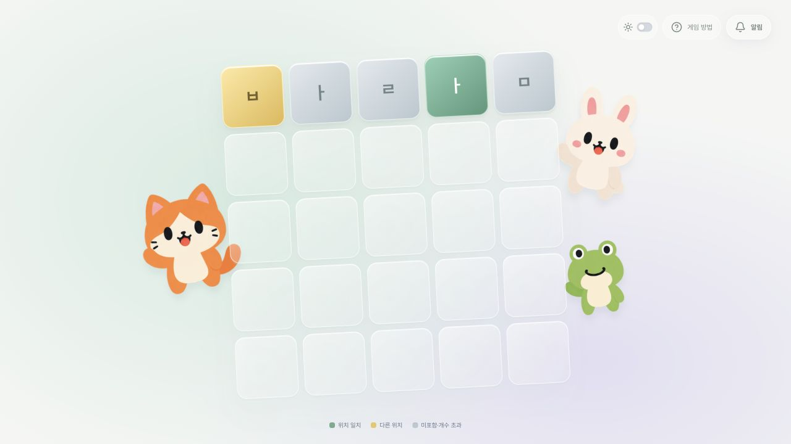
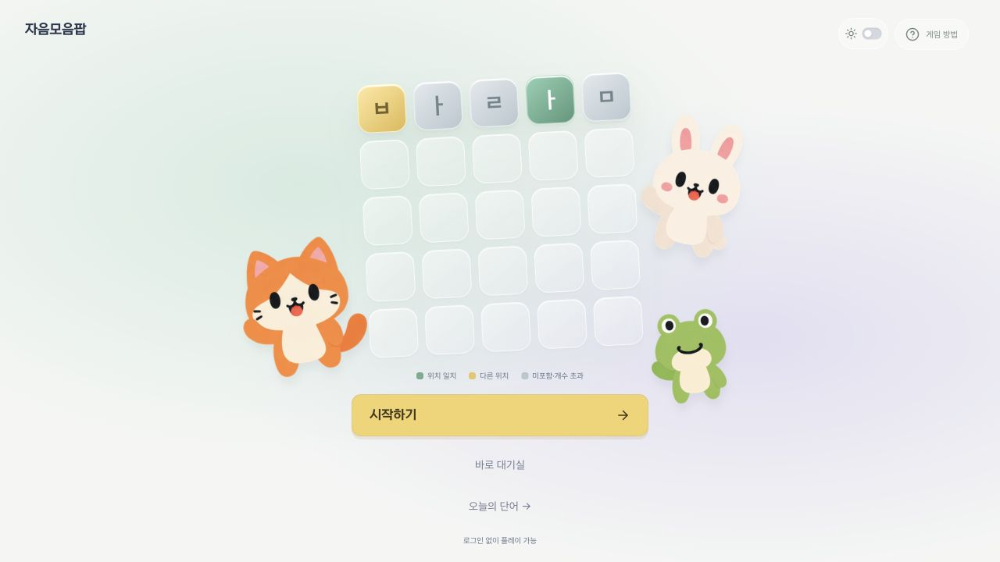

# 첫 방문 플레이 화면 기준

첫 화면에서 시작하고 한 판을 끝내는 동안, 시각적 소개보다 다음 행동을 먼저 찾을 수 있게 한다.

## 배치와 상태

- 25칸과 콩알 캐릭터는 유지하며 시작 버튼은 1280×720 및 작은 화면의 첫 뷰포트에 둔다. 서비스명은 작은 고정 표기로 제공한다.
- 연습·오늘의 단어·개인 도전은 짧은 화면에서 보드와 자판·제출을 함께 보여준다. 글자 크기와 버튼 접근성을 줄이는 대신 보조 여백과 헤더를 먼저 압축한다.
- 층 이야기는 펼쳐서 볼 수 있다. 개인 도전 지도에는 사용 가능한 다음 단계 또는 진행 중인 도전을 바로 여는 버튼을 제공한다. 기존 도전을 새 판으로 덮어쓰지 않는다.
- 게스트 기록 안내는 접힌 상태로 제공하며 연결 요청은 사용자가 펼치고 직접 실행한다. 진행·보상·계정 식별이나 연결 동의는 변경하지 않는다.
- 최초 로딩에는 상태 안내만 표시한다. 실패한 경우에만 재시도를 제공하고, 재시도 중에는 이전 오류와 중복 재시도 버튼을 숨긴다.
- 첫 화면↔연습, 대기실↔입장↔게임방, 개인 지도↔풀이의 **장면 식별자**가 바뀔 때만 스크롤을 맨 위로 옮긴다. 주기 조회·입력·제출 횟수 변경으로 스크롤을 초기화하지 않는다.
- 실제 한글 IME의 native input 크기·조합 처리·캐럿 동작은 이 배치 작업에서 수정하지 않는다.

## 확인 근거 — 2026-10-18

운영과 같은 코드 기반의 로컬 DB에서 확인했다.

| 확인 | 결과 |
| --- | --- |
| 1280×720 첫 화면 시작 버튼 | 하단 y=559px (이전 상단 y=722px로 화면 밖) |
| 1280×720 연습 제출 | 하단 y≈674px, 스크롤 0에서 자판과 함께 노출 |
| 연습 완주 | 바람→사과→수박의 색상 안내와 완료 후 진입 버튼 확인 |
| 1280×720 오늘의 단어 제출 | 하단 y≈685px, 스크롤 0 |
| 1280×720 개인 도전 여섯 줄 제출 | 하단 y≈702px, 스크롤 0 |
| 긴 대기실 하단의 방 선택→입장→게임방 | 입장과 게임방의 scrollTop=0 확인 |
| 390×812, 375×667 | 별도 iframe 뷰포트로 첫 화면·일일 게임 배치 확인. 실제 iOS/Android 입력 검증을 뜻하지 않음 |
| 공통 비동기 상태 | 로딩/실패/재시도 중의 접근성 상태와 재시도 버튼 노출을 자동 검사 |

기본 상태(도움말·기록 안내 접힘)의 화면 기준이다. 사용자가 설명을 펼치거나 큰 글자/확대를 사용하는 경우에는 스크롤을 허용하며 내용을 잘라 숨기지 않는다. 실기기 한글 조합·화면 읽기·느린 네트워크에서의 전체 인수는 별도 검증한다.

## 전후 화면

같은 1280×720, 밝은 테마에서 비교한다.

