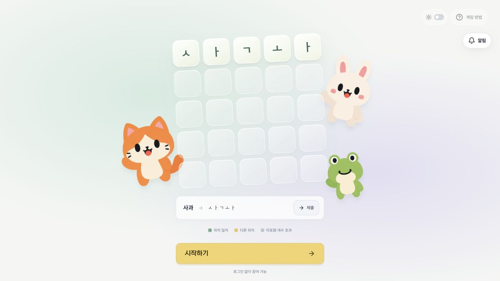
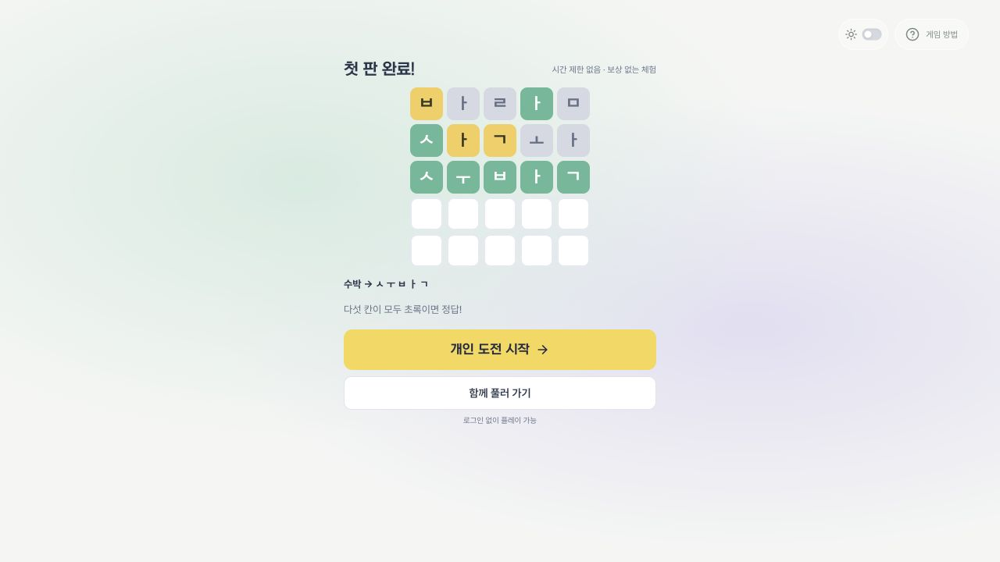
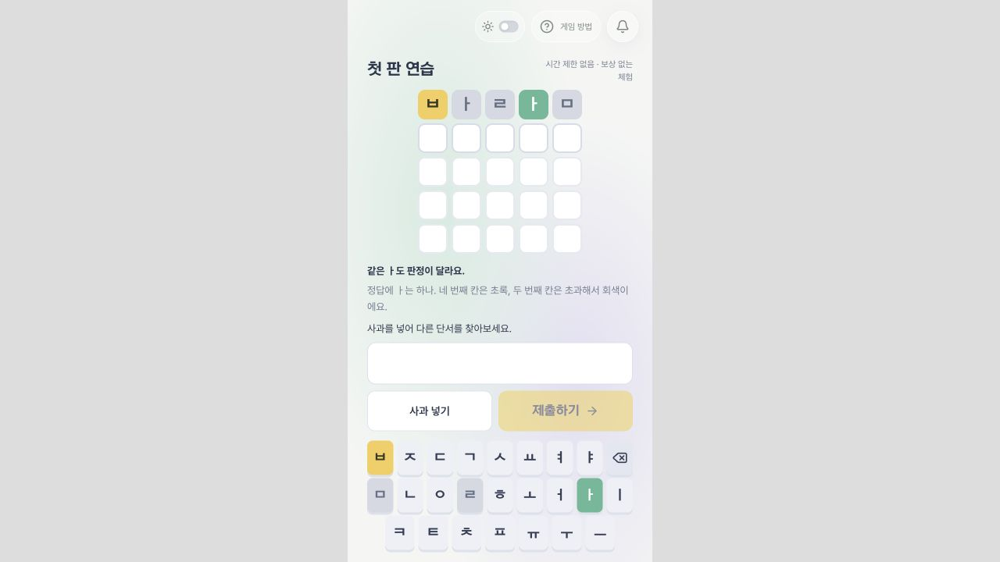

# 처음 온 사람의 첫 판 (#14)

## 동작

- 홈의 시작하기는 로그인/방 생성 없이 세 번의 안내된 제출을 시작한다. 바람 → 사과 → 수박으로 자모 분해, 중복 자모의 개수, 판정색을 확인한다.
- 체험 상태는 탭의 sessionStorage에만 보관한다. 서버 판·XP·골드·순위에 반영하지 않는다. 새로고침 후 완료한 단계부터 이어간다.
- 완료 후 개인 도전 시작 또는 대기실을 선택한다. 건너뛰기도 가능하다.
- `/solo?start=1`은 기록 확인 후 진행 중인 도전을 복원하거나 다음 해금 단계를 시작한다. 재전송은 기존 solo API의 이전 실행 ID와 revision 검사로 보호한다.
- 대기실에서도 방 목록 상태와 무관하게 개인 도전을 시작할 수 있다. 첫 플레이 전 헤더·옷장 바로가기는 일반 플레이와 개인 도전을 우선하며 상점 자체 접근을 막지는 않는다.

## 계정 연결

- 기존 방 기록 연결에 개인 도전 연결을 추가한다. 로그인 후 연결 가능한 게스트 기록이 있으면 현재 화면에 연결 버튼을 보여준다.
- 계정의 개인 도전이 비어 있으면 게스트의 상태·진행 중 입력 판·최고 별·XP·플레이 이력을 이동한다. 게스트 진행 행은 빈 상태로 바꿔 중복 소유를 막는다. 새 SQL/스키마 변경은 없다.
- 계정에도 개인 도전 기록이 있으면 덮어쓰거나 자동 합산하지 않는다. 게스트 기록을 유지하며 로그아웃 후 이용하도록 안내한다.
- 두 snapshot의 revision과 state를 트랜잭션에서 검사한다. 다른 탭에서 진행이 바뀌면 이전 snapshot으로 덮지 않고 재시도를 안내한다.
- 로그인 전 현재 경로와 초대 쿼리를 return_to로 보존한다. OAuth 취소는 해당 경로로, 토큰 교환 실패의 다시 로그인도 해당 경로로 돌아온다. 허용한 사이트 내부 경로만 사용한다.

## 검증과 배포

자동 테스트: 체험 판정/복원, 계정 API의 개인 도전 단독 연결, 중복 연결, 계정 양쪽 기록 충돌, 게스트/계정 동시 변경, Google 취소/교환 실패 복귀 경로. 기존 입력·방·보상 회귀 검사 포함.

브라우저 로컬: 홈 → 세 번 제출 → 새로고침 복원 → 개인 도전 자동 시작 → 제출 → 새로고침 → 가짜 로컬 계정 연결 → 같은 판·시도 보존 → 완료. 빈 대기실의 개인 도전 진입과 390px 화면도 확인한다.

실제 Google 서비스 로그인, 실제 휴대폰 IME/시스템 자판, 설명을 듣지 않은 외부 사용자의 완주율은 별도 인수 확인 항목이다. 로컬 계정 테스트를 실제 Google 로그인 검증으로 간주하지 않는다.

DB 마이그레이션은 없다. 운영 배포는 PR 병합 후 기존 Cloudflare 절차를 따른다. 코드 롤백은 이전 버전으로 가능하지만 이미 사용자가 명시적으로 연결한 기록은 계정 소유로 유지해야 한다.

## 화면 비교

변경 전 홈(운영 화면):

변경 후 체험 완료(로컬):

390px 프레임(로컬, 실기기 검증 아님):

