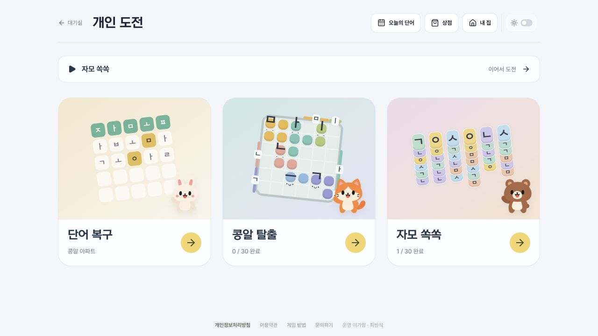
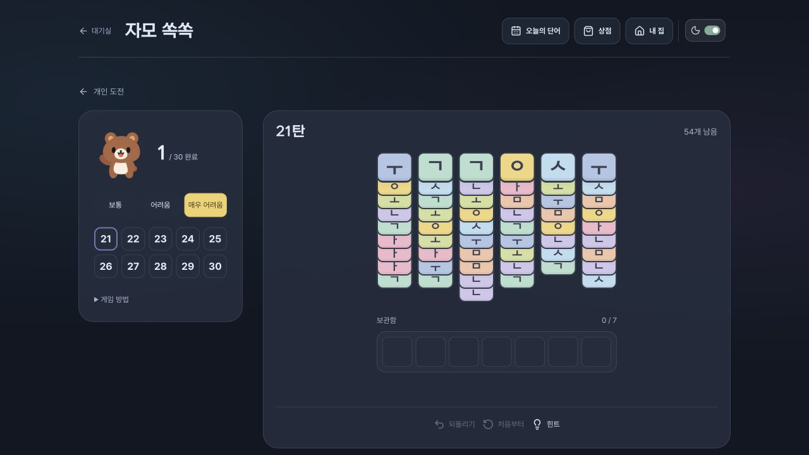
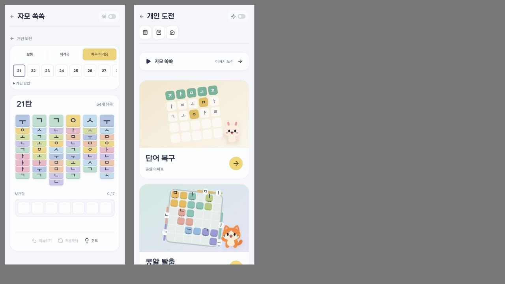

# 개인 도전 · 자모 쏙쏙

## 진입과 규칙

`/solo`에서 단어 복구·콩알 탈출·자모 쏙쏙을 선택한다. `/solo/stack`은 보통부터 시작하는 30판(난이도별 10판)이며 모든 난이도를 바로 선택할 수 있다. 최근 게임 이어가기에 세 게임을 구분한다.

각 열의 맨 위 자모를 클릭/터치 또는 숫자키 1~6으로 선택한다. 같은 자모 세 개가 보관함에 모이면 즉시 제거된다. 보관함은 일곱 칸이며, 여섯 개를 보관 중에도 다음 자모로 세 개를 완성하면 제거 후 계속한다. 일곱 칸이 차면 추가 선택을 막되 되돌리기는 가능하다. 아래 타일의 글자도 미리 볼 수 있다.

정답 단어·시간 제한은 없다. 보통 36개/5종, 어려움 45개/6종, 매우 어려움 54개/8종이다. 30판 모두 저장된 풀이와 실제 탐색 결과를 재생해 검증했다. 같은 난이도 내 번호가 인간 체감 난이도의 단조 증가를 보장하지 않는다. 생성 후보 선정 시 사용한 탐욕 봇의 성공 비율은 사람 성공률이 아니다.

## 진행과 안전

- 브라우저 전용 `jamopop-stack-v1`: 현재 판, 선택 경로, 완료 목록. 복원 시 엔진으로 선택을 재생·검증한다.
- 저장 차단/용량 부족 시 게임은 유지하고 저장 실패를 안내한다. 브라우저 데이터 삭제 시 기록은 복구할 수 없다.
- 계정 전적·XP·골드·상점 보상과는 별개. 기존 단어/탈출 저장 키와 운영 DB를 변경하지 않는다.
- 힌트는 요청할 때만 웹 워커 탐색. 판 변경·입력·되돌리기·이탈 시 작업 중단, 오래된 응답 차단. 탐색 한도 초과를 불가능한 판으로 단정하지 않는다.
- 동작 줄이기 설정에서는 힌트/매칭 애니메이션을 제거한다.

## 검증

`tests/jamo-stack.test.mjs`: 30판별 삼중 자모 수량, 타일 식별자, 증명·힌트 풀이, 원본 불변, 여섯 칸에서 매칭, 실패 후 복구, 잘못된 입력·저장값, 타 게임 키 보존. 실제 브라우저 확인은 PR에 별도 기재한다.

DB 마이그레이션 없음. 기존 Cloudflare main 자동 배포 사용. 서버 기록이 바뀌지 않아 코드 롤백 시 기존 기록 영향 없음.

## 실행 결과

- 전체 테스트 194개, 타입·포맷·공개 소스 검사·빌드 통과.
- 로컬 실제 UI에서 한 판 완주, 완료 표시, 실패 후 추가 선택 차단·되돌리기, 숫자키, 힌트, 새로고침 복원 확인.
- 라이트/다크, 390×844 CSS 프레임에서 매우 어려움 보드·보관함·도구 노출 확인. 실제 휴대폰 터치는 미확인.
- 탈출/단어 복구 기록은 수정하지 않았으며 운영 DB를 사용하지 않음.

