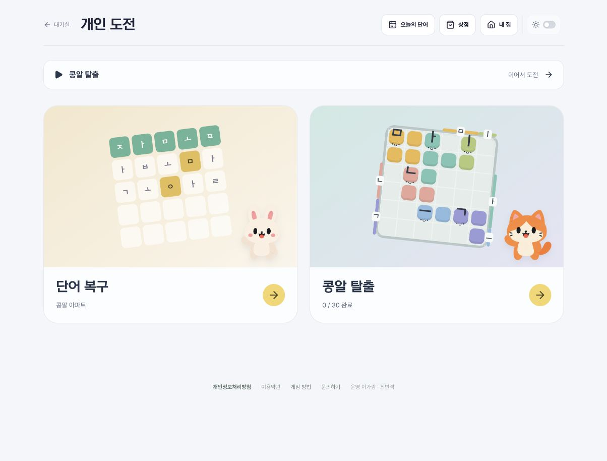
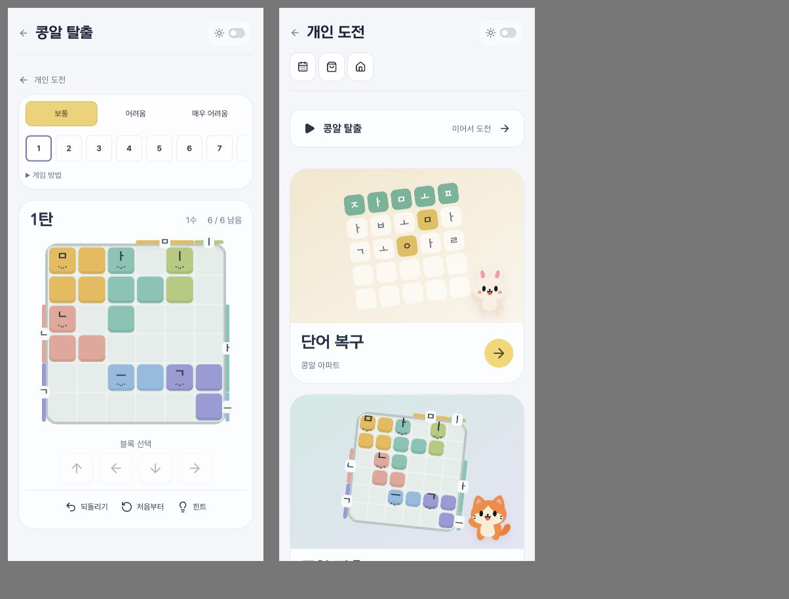

# 개인 도전 · 콩알 탈출

## 진입

- `/solo`: 게임 선택. 단어 복구 / 콩알 탈출. 최근 방문한 게임 이어가기.
- `/solo/word`: 기존 개인 도전. 기존 `/api/solo`, 계정·게스트 기록과 보상 유지.
- `/solo?start=1`: `/solo/word?start=1`로 연결. 기존 첫 판 진입 링크 유지.
- `/solo/exit`: 콩알 탈출 30판. 보통·어려움·매우 어려움 각 10판, 모든 난이도 바로 선택 가능.

## 게임과 진행

6×6 보드의 자모 블록을 각 글자 출구로 이동한다. 클릭 선택 후 방향키/버튼, 터치 드래그로 한 칸씩 이동한다. 한 칸 이동은 1수이며 출구 이동도 포함한다. 되돌리기·다시 시작·웹 워커 힌트를 제공한다. 힌트 탐색 예산 초과를 막힌 판으로 단정하지 않는다.

진행은 **이 브라우저** `jamopop-exit-v1`에 저장한다. 저장된 이동을 현재 엔진으로 재생해 복원한다. 계정 동기화·전적·XP·골드 지급은 이번 범위에 없다. 도움말에서 저장 범위를 안내한다. 기존 단어 도전 기록과 키를 공유하지 않는다. 쿠키/브라우저 데이터 삭제 시 탈출 진행은 복구할 수 없다.

고정 카탈로그는 보통부터 시작한다. 블록 6→7→8개, 점유 18→22→26칸으로 늘어난다. 역구성 후보를 실제 엔진으로 재생해 검증했다. `tests/exit-proofs.json`에 각 판의 검증 경로가 있다. 힌트는 weighted A*로 최단 풀이를 보장하지 않는다. 같은 난이도 안의 1~10 순서는 인간 난이도 순으로 검증한 결과가 아니다. 장애물과 1000판 자동 생성은 포함하지 않는다.

## 검증·배포

`tests/kongal-exit.test.mjs`: 전 판 검증 경로/힌트 재생, 초기 겹침·경계, 비정상 이동, 손상 저장값, 저장 실패, 기존 키 보존.

DB·계정·기존 게임 규칙 변경 및 마이그레이션 없음. PR 병합 시 기존 Cloudflare 자동 배포 사용. 롤백해도 서버 기록에 영향 없음. 탈출 로컬 저장 키는 별도 보존된다.

## 화면 확인

- 로컬 PC: 허브 → 탈출 → 힌트 → 실제 이동 → 새로고침 복원 → 되돌리기. 방향키 입력 확인.
- 390×844 CSS 프레임: 선택 화면, 보드·이동 버튼·도구 노출 및 가로 넘침 수정 확인. 실제 휴대폰 터치/스와이프는 미확인.
- 단어 복구 기존 화면 진입 확인. 운영 계정/DB는 사용하지 않음.
- 전체 테스트 159개, 타입 검사, 포맷 검사, 공개 소스 검사 및 앱 빌드 통과.

