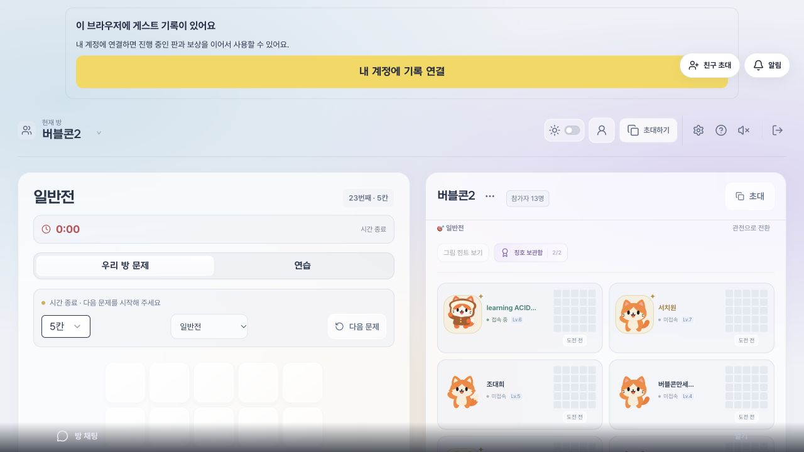
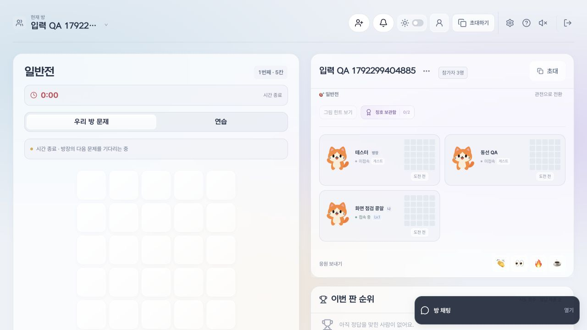
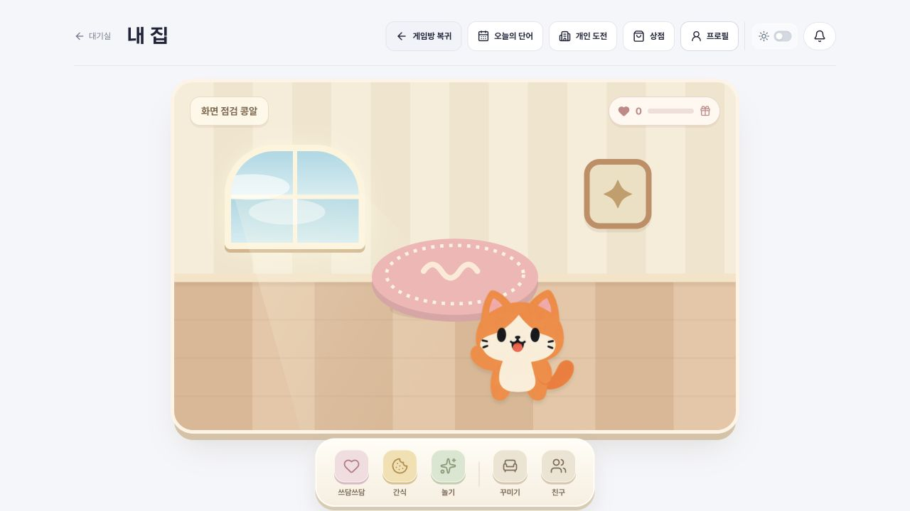
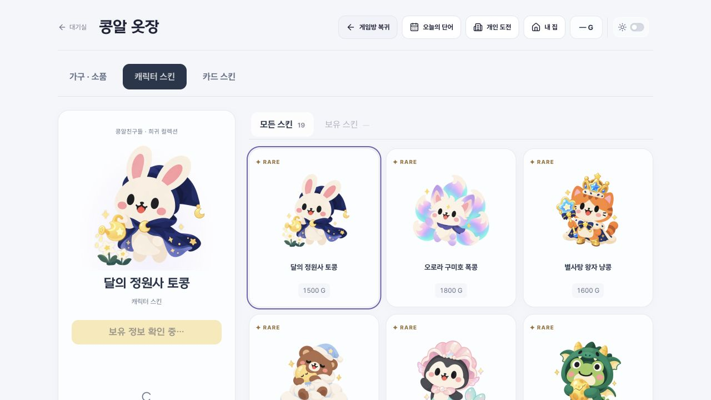
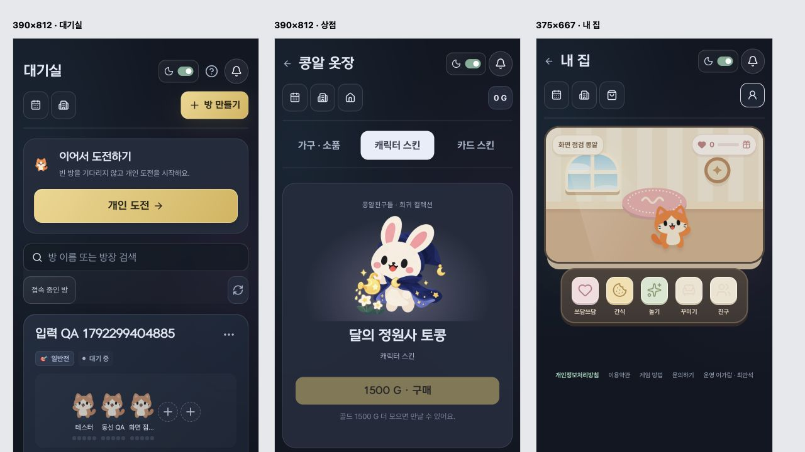

# 화면 계층·계정 로딩·복귀 동선

## 화면 계층

- 게임판 위의 채팅은 30, 친구 알림은 40, 모달 배경/내용은 80/81 계층을 사용한다. 값은 `overlay-system.css`의 토큰에서 관리한다.
- Radix 모달은 `aria-modal` 속성이 생략되는 경우도 있어 실제 포털의 `dialog-overlay`/`alert-dialog-overlay` 존재를 기준으로 판단한다. 별도 구현한 `aria-modal=true`도 인식한다. `aria-modal=false`인 친구 알림만 열었을 때는 전체 화면을 모달로 취급하지 않는다.
- `OverlayState`의 단일 관찰자로 모달 여부를 공유한다. 모달 동안 채팅·친구 알림은 숨기고 inert로 조작을 막는다. 메시지·초안·읽음 기록은 삭제하지 않는다. 채팅의 모바일 스크롤 잠금도 모달 동안 해제한다.
- 닫힌 채팅은 우측 하단의 작은 버튼/최근 대화 영역으로 표시한다. 전체 폭 그라데이션은 대화를 펼쳤을 때 사용한다. 엑셀 모드의 셀 표현은 유지한다.
- 친구 알림은 모든 서비스·일반전·스피드전 헤더의 동일 슬롯에 배치한다. 슬롯이 없는 페이지에 고정 알림 버튼을 임의로 띄우지 않는다.

## 로딩과 재시도

- 계정 확인 전에는 게스트라고 단정하지 않는다. 보유 스킨 개수와 골드는 `—`로 두고, 구매·장착 버튼은 비활성화한다. 공개 가격과 상품 둘러보기는 유지한다.
- 상점은 캐릭터/카드·가구가 같은 `useShopWallet`을 사용한다. 최초 읽기·변경 요청은 동기 ref 잠금으로 중복을 막는다. 화면을 떠난 뒤 도착한 응답은 무시하며 이전 요청이 새 요청의 잠금을 해제하지 못한다.
- 네트워크 오류는 로그인 만료로 표시하지 않는다. 401이 확정되면 보유 정보를 비우고 로그인 안내를 제공한다. 성공한 응답만 실제 골드/보유/장착 상태를 바꾼다.
- 최초 대기/실패/재시도는 `AsyncStatus`를 사용한다. 재시도 중에는 이전 오류와 재시도 버튼을 숨긴다. 프로필·내 집도 가짜 초기 프로필/기본 집을 회원 정보처럼 먼저 표시하지 않는다.
- 상점 분류는 URL 및 브라우저 뒤로가기와 함께 바뀐다. 가구 상점을 여는 순간 캐릭터 상점도 동시에 읽지 않는다.

## 복귀

- 공통 헤더 왼쪽의 `대기실`은 항상 방 목록으로 간다. 같은 탭에 유효한 게임방 문맥이 있으면 주 메뉴에 별도의 `게임방 복귀`를 제공한다.
- 프로필·상점·개인 도전·일일·게임 방법·문의/정책 페이지에서 같은 기준을 쓴다. 작은 화면에도 복귀 버튼의 짧은 글자를 남긴다.
- 기존 방 ID·모드·초안의 sessionStorage 복원 규칙을 사용한다. 명시적으로 방 목록으로 나가거나 로그아웃하면 복귀 문맥은 지우되 제출·최근 방·기록은 지우지 않는다.

## 검증 — 2026-10-18

- 실제 상점 훅에 미응답 읽기, 연속 구매 클릭, 통신 실패와 재시도, 401, 화면 교체 후 늦은 응답을 자동 시험했다.
- 로컬 DB에만 만든 별도 계정으로 대기실/게임방의 설정·도움말을 열어 채팅/친구 알림의 hidden·inert 상태를 확인했다. 닫은 뒤 채팅의 작성 중 초안도 보존됐다.
- 게임방 → 내 집/프로필 → 상점 → 같은 게임방, 도움말 페이지 → 같은 게임방, 스킨↔가구의 브라우저 뒤로가기를 확인했다.
- 로컬 프록시로 3.5초 통신 지연과 상점 503 후 정상 응답을 재현했다. 내 집/프로필은 로딩 안내만, 상점은 `—`와 비활성 행동을 표시하며 복구 후 실제 보유 스킨 1개를 표시했다.
- 작은 화면은 별도 iframe의 390×812/375×667 배치 확인이다. 실제 iOS 시스템 자판·스크린리더 인수나 Google OAuth 시험을 뜻하지 않는다.

운영 API·스키마·계정 식별·보상 규칙은 변경하지 않는다. 운영 데이터 변경이나 마이그레이션은 없다.

## 화면

변경 전은 앞선 운영 화면 감사에서 촬영한 것으로 방/참가자/기록 연결 상태는 변경 후의 로컬 테스트와 다르다. 이번 비교 대상은 채팅의 전체 폭과 헤더 밖에 떠 있던 알림이다. 게스트 기록 안내 접기는 앞선 PR #63에서 처리했다.

