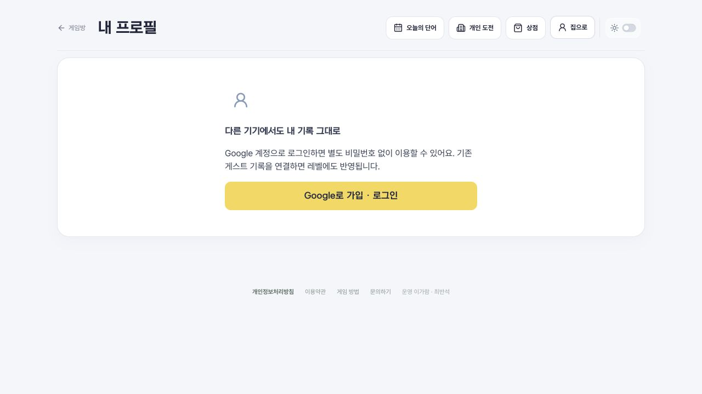
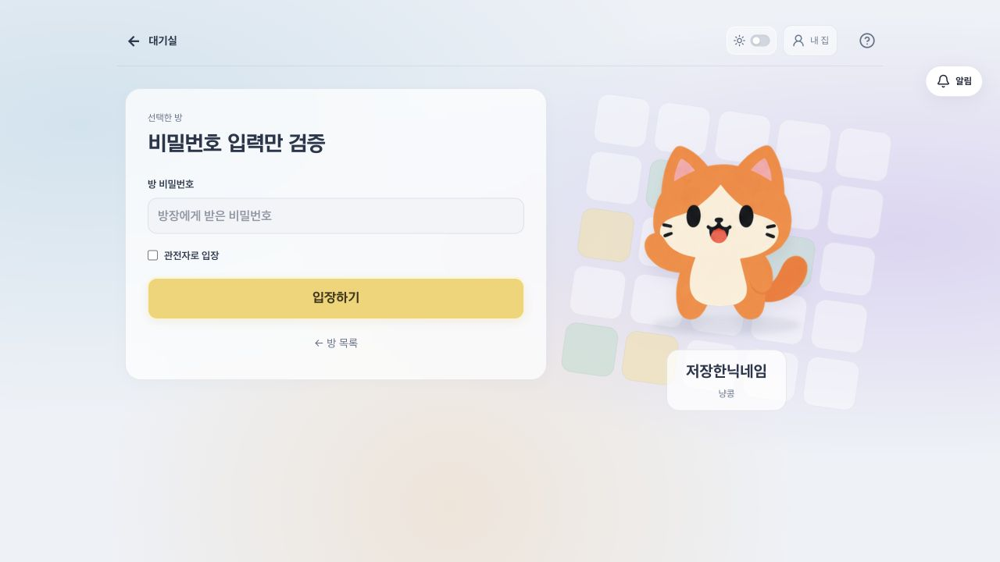

# 입장과 게임방 복귀

- 기존 기록 조회가 끝나기 전에는 닉네임/캐릭터 폼을 그리지 않는다. 조회 지연·새로고침·방 전환 시 입장 상태를 보여주고, 현재 방의 401/403이 확정된 경우에만 필요한 설정을 제공한다. 이전 방의 완료/실패 응답은 새 방의 로딩·연결 상태를 바꾸지 않는다.
- 회원의 새 방 입장은 POST로 처리한다. 검증된 로그인 계정의 저장 프로필(없으면 최근 방의 프로필)을 사용하며 요청 본문의 닉네임/캐릭터로 덮어쓰지 않는다. 둘 다 없으면 임시 콩알 닉네임을 쓴다. 기존 방 닉네임·회원 ID·제출은 유지한다. 동명이인은 해당 방에서만 `·2` 등의 번호를 붙인다. 게스트 입력 흐름·비밀번호·관전·강퇴 제한은 유지한다.
- 같은 탭에서 실제 입장한 방/모드만 sessionStorage에 기억한다. 공통 헤더는 프로필·상점·개인 도전·도움말 등에서 그 방으로 돌아가는 링크를 제공한다. 명시적 퇴장/로그아웃은 복귀 문맥만 지우고, 최근 방·초안·서버 기록은 지우지 않는다. 잘못된 값/만료된 값/다른 탭은 대기실 링크로 돌아간다.

## 확인

`npm run ci`: 117개 자동 검사·형식·공개 자산·타입·빌드 통과. 실제 동기화 훅에 지연 응답/요청 교체/회원 자동 입장/현재 방 거절을 시험하고, 실제 SQLite API에 저장 프로필·동명이인·회원 ID 유지·비밀번호 없는 입장 거부를 확인했다.

로컬의 별도 가상 세션/프로필과 테스트 방으로 브라우저를 검증했다. 조회만 2.5초 지연시켜 입장 폼이 나타나지 않는 것을 확인했고, 게임방 → 내 집/프로필 → 게임방에서 같은 판과 작성 중 `바람`이 복원됐다. 합성 로그인 세션은 실제 Worker 세션 검증을 통과했으나 Google OAuth 로그인 인수 시험을 대신하지 않는다. 운영 데이터 변경/마이그레이션은 없다.

